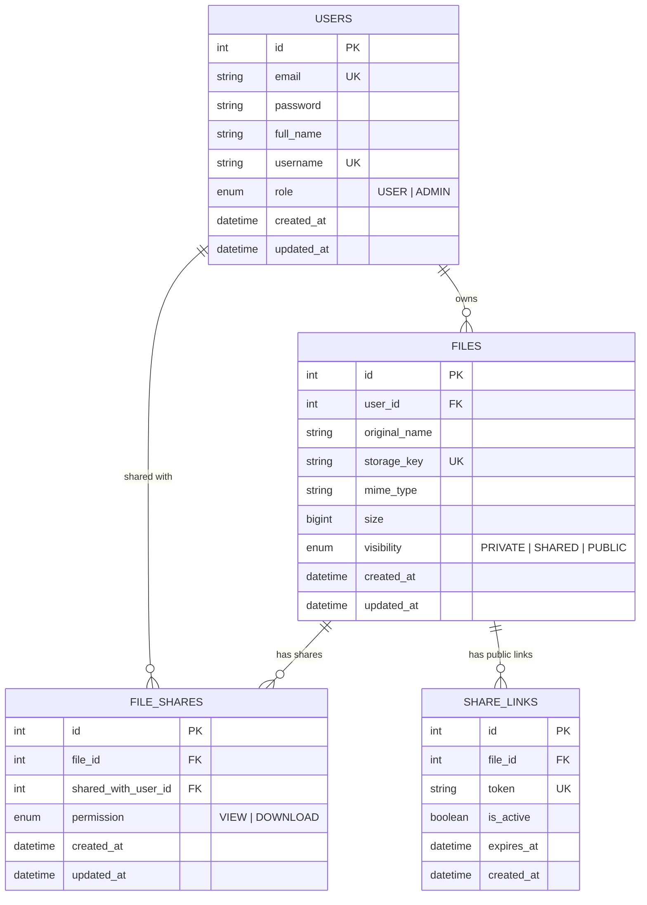

# Simple File Storage API - Backend Service

Hệ thống Backend RESTful API cho ứng dụng lưu trữ và chia sẻ file cá nhân tương tự Google Drive phiên bản tinh gọn, xây dựng trên nền tảng **NestJS**, **MySQL 8.4**, **TypeORM**, **JWT Authentication**, và thiết kế trừu tượng sẵn sàng cho **AWS S3**.

---

## 1. Công nghệ & Thư viện sử dụng

- **Framework**: NestJS 12 (Express, TypeScript ESM)
- **Database & ORM**: MySQL 8.4, TypeORM với cơ chế Migration
- **Authentication**: Passport JWT, bcrypt password hashing
- **File Storage**: Trừu tượng hóa Storage Service (`LocalStorageService` và `S3StorageService` chuẩn bị cho AWS S3 với AWS SDK v3)
- **API Documentation**: Swagger UI (`/api/docs`)
- **Validation & Security**: `class-validator`, `class-transformer`, `helmet`, rate-limiting (`@nestjs/throttler`), secure path sanitization, cryptographically secure tokens (`crypto.randomBytes`)
- **Testing**: Vitest (Unit tests & E2E integration tests)
- **Containerization**: Dockerfile & Docker Compose

---

## 2. Kiến trúc & Cấu trúc thư mục

```text
storage-service-api/
├── src/
│   ├── main.ts                           # Khởi tạo NestJS, prefix /api, Swagger, Helmet, Validation
│   ├── app.module.ts                     # Module gốc, cấu hình Config, TypeORM, Throttler, Interceptors
│   ├── common/
│   │   ├── decorators/                   # @CurrentUser, @Public, @Roles
│   │   ├── enums/                        # FileVisibility, SharePermission, Role
│   │   ├── exception-filters/            # AllExceptionsFilter (chuẩn hóa lỗi HTTP)
│   │   ├── interceptors/                 # TransformInterceptor (StreamableFile aware), LoggingInterceptor
│   │   ├── middleware/                   # RequestIdMiddleware
│   │   └── utils/                        # hash.util.ts (bcrypt)
│   ├── config/
│   │   └── data-source.ts                # TypeORM DataSource cho CLI Migration
│   ├── database/
│   │   └── migrations/                   # Các file TypeORM migrations
│   ├── storage/
│   │   ├── interfaces/                   # StorageService interface & upload/download types
│   │   ├── local-storage.service.ts      # Lưu trữ local an toàn, chống path traversal
│   │   ├── s3-storage.service.ts         # Triển khai AWS S3 với @aws-sdk/client-s3 & presigner
│   │   ├── storage.constants.ts          # STORAGE_SERVICE injection token
│   │   └── storage.module.ts             # StorageModule xuất STORAGE_SERVICE theo driver (local/s3)
│   ├── auth/                             # Đăng ký, đăng nhập, JWT, /api/auth/*
│   ├── users/                            # Quản lý profile, tìm kiếm email, /api/users/*
│   ├── files/                            # Upload, tải về, xem chi tiết, xoá, visibility, /api/files/*
│   ├── file-shares/                      # Chia sẻ file qua email, phân quyền VIEW/DOWNLOAD, /api/files/:id/shares
│   └── share-links/                      # Tạo public link với token ngẫu nhiên, /api/public/files/*
├── test/
│   └── app.e2e-spec.ts                   # 28 bài test E2E kiểm thử toàn bộ luồng nghiệp vụ
├── compose.yaml                          # Docker Compose cho app & MySQL 8.4
├── Dockerfile                            # Image build production
├── .env.example                          # Mẫu cấu hình môi trường
└── README.md                             # Tài liệu hướng dẫn
```

---

## 3. Database Schema



---

## 4. Danh sách API (Prefix `/api`)

### 4.1. Authentication
| Method | Endpoint | Quyền | Mô tả |
|---|---|---|---|
| `POST` | `/api/auth/register` | Public | Đăng ký tài khoản mới (`email`, `password`, `fullName`) |
| `POST` | `/api/auth/login` | Public | Đăng nhập nhận JWT access token (`email`, `password`) |
| `GET` | `/api/auth/me` | Bearer Token | Lấy thông tin user đăng nhập hiện tại |

### 4.2. Users
| Method | Endpoint | Quyền | Mô tả |
|---|---|---|---|
| `GET` | `/api/users/me` | Bearer Token | Lấy hồ sơ cá nhân |
| `PATCH` | `/api/users/me` | Bearer Token | Cập nhật thông tin cá nhân cơ bản (`fullName`) |
| `GET` | `/api/users/search?email=` | Bearer Token | Tìm kiếm người dùng theo email để phục vụ chia sẻ file |

### 4.3. Files
| Method | Endpoint | Quyền | Mô tả |
|---|---|---|---|
| `POST` | `/api/files/upload` | Bearer Token | Upload file (multipart/form-data, max 50MB) |
| `GET` | `/api/files` | Bearer Token | Danh sách file của user (hỗ trợ search, filter visibility, pagination, thống kê tổng số file & dung lượng) |
| `GET` | `/api/files/:id` | Bearer Token | Lấy chi tiết file (kiểm tra quyền sở hữu, chia sẻ hoặc file public) |
| `GET` | `/api/files/:id/download` | Bearer Token | Tải file (chỉ cho phép chủ sở hữu hoặc người được cấp quyền DOWNLOAD) |
| `DELETE` | `/api/files/:id` | Bearer Token | Xóa file khỏi hệ thống (chỉ chủ sở hữu, tự động xóa cascading shares và links) |
| `PATCH` | `/api/files/:id/visibility` | Bearer Token | Cập nhật chế độ hiển thị file (`PRIVATE`, `SHARED`, `PUBLIC`) |

### 4.4. File Sharing
| Method | Endpoint | Quyền | Mô tả |
|---|---|---|---|
| `POST` | `/api/files/:id/shares` | Bearer Token | Chia sẻ file với người dùng khác qua email (quyền `VIEW` hoặc `DOWNLOAD`) |
| `GET` | `/api/files/:id/shares` | Bearer Token | Lấy danh sách người được chia sẻ file |
| `PATCH` | `/api/files/:id/shares/:shareId` | Bearer Token | Cập nhật quyền chia sẻ (`VIEW` / `DOWNLOAD`) |
| `DELETE` | `/api/files/:id/shares/:shareId` | Bearer Token | Thu hồi quyền chia sẻ |
| `GET` | `/api/files/shared-with-me` | Bearer Token | Danh sách file người khác chia sẻ với tôi kèm quyền |
| `GET` | `/api/files/shared-by-me` | Bearer Token | Danh sách file tôi đã chia sẻ cho người khác |

### 4.5. Public Share Links
| Method | Endpoint | Quyền | Mô tả |
|---|---|---|---|
| `POST` | `/api/files/:id/share-links` | Bearer Token | Tạo link chia sẻ công khai với token ngẫu nhiên bảo mật và thời hạn tuỳ chọn |
| `GET` | `/api/files/:id/share-links` | Bearer Token | Xem danh sách các share links của file |
| `DELETE` | `/api/files/:id/share-links/:linkId` | Bearer Token | Vô hiệu hoá / thu hồi share link |
| `GET` | `/api/public/files/:token` | **Public** | Xem thông tin file qua token công khai (không cần đăng nhập) |
| `GET` | `/api/public/files/:token/download` | **Public** | Tải file qua token công khai (không cần đăng nhập) |

---

## 5. Hướng dẫn khởi chạy dự án

### Cách 1: Khởi chạy bằng Docker Compose (Khuyên dùng)

1. Sao chép file môi trường:
```bash
cp .env.example .env
```
2. Khởi chạy toàn bộ hệ thống (App + MySQL 8.4):
```bash
docker compose up -d
```
3. Truy cập Swagger UI tại:
```text
http://localhost:3000/api/docs
```

### Cách 2: Chạy trực tiếp trên máy Host

1. Khởi chạy container MySQL:
```bash
docker compose up mysql -d
```
2. Cài đặt dependencies:
```bash
npm install
```
3. Chạy Migration tạo bảng dữ liệu:
```bash
npm run migration:run
```
4. Khởi chạy server ở chế độ phát triển:
```bash
npm run start:dev
```
5. Mở trình duyệt xem tài liệu API Swagger:
```text
http://localhost:3000/api/docs
```

---

## 6. Kiểm thử tự động (Testing)

Dự án có bộ test suite đầy đủ bao gồm **Unit Tests** và **Integration E2E Tests**:

```bash
# 1. Chạy toàn bộ Unit Tests (48 tests)
npm run test

# 2. Chạy toàn bộ E2E Tests trên database thực tế (28 tests)
npm run test:e2e
```

**Tiêu chí kiểm thử đã đạt 100%:**
- Đăng ký, đăng nhập và cấp phát JWT token.
- Bảo vệ các API yêu cầu đăng nhập.
- Upload file lên local storage an toàn, lưu metadata vào MySQL.
- Download file bằng StreamableFile với đầy đủ Content-Disposition và Mime-type.
- Ngăn chặn truy cập trái phép vào file PRIVATE.
- Chia sẻ file qua email và phân biệt quyền VIEW / DOWNLOAD.
- Tạo public share link với token khó đoán 64 ký tự hex.
- Kiểm tra trạng thái kích hoạt và thời hạn của public link.
- Xóa file vật lý và cascade xóa toàn bộ shares / share links trong MySQL.
